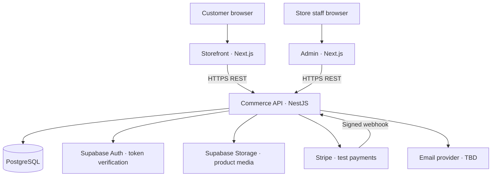
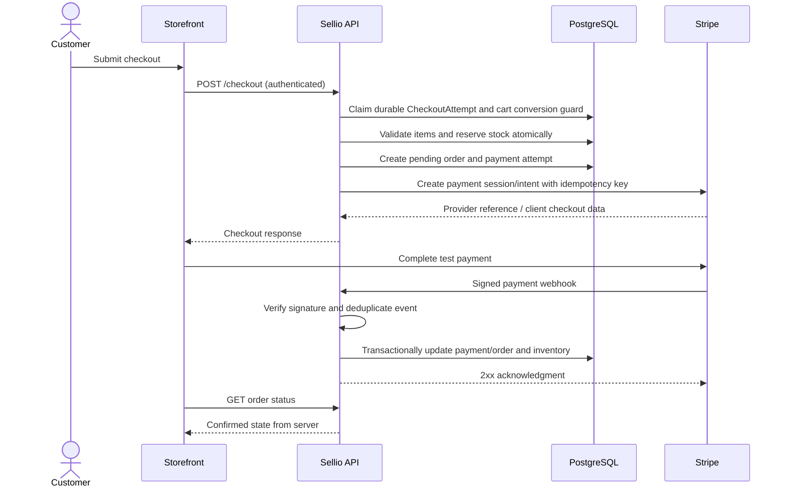

# Sellio — System Architecture Document

**Version:** 0.1 (Draft)  
**Last updated:** 2026-11-19  
**Status:** Proposed architecture; subject to implementation review  
**Related document:** [PRD](Sellio_PRD.md)

## 1. Purpose and scope

This document describes the initial technical architecture of **Sellio**, a headless, single-store e-commerce platform with a reference consumer-electronics storefront. It is intended to guide implementation, architectural review, and future integration work. The PRD is the source of truth for product scope; this document describes how the product is expected to be built.

**V1 priorities:** a complete test-mode purchase flow, reliable stock accounting, secure authorization, reusable commerce logic, operational visibility, and maintainable code. **Out of scope:** multi-tenancy, microservices, marketplace settlements, production card-data handling, and a mobile app.

## 2. Architectural principles

1. **Modular monolith:** deploy the commerce API as one NestJS service, with clear business module boundaries.
2. **Headless commerce:** expose business operations through versioned APIs; do not place authoritative commerce rules in the frontend.
3. **Single store first:** avoid tenant identifiers and tenant isolation machinery until a validated multi-store requirement exists.
4. **Server authority:** the API determines prices, discounts, stock, order totals, permissions, and payment state.
5. **Safe external integration:** verify provider signatures, make asynchronous handlers idempotent, and reconcile uncertain outcomes.
6. **Incremental delivery:** ship thin, tested vertical slices rather than implementing every module at once.
7. **Observable behavior:** structured logs, correlation IDs, audit-relevant events, and explicit failure states.

## 3. System context



**Trust boundaries:** browsers and incoming webhook requests are untrusted; the API validates every request. Credentials, service-role keys, webhook secrets, and database credentials remain server-side. Frontends may use public Supabase configuration but never privileged keys.

## 4. Applications and responsibilities

| Component | Technology (proposed) | Responsibilities | Must not own |
|---|---|---|---|
| Storefront | Next.js, TypeScript, Tailwind CSS | Catalog browsing, search/filter UI, cart UX, customer account and checkout UX | Final pricing, stock reservations, payment confirmation |
| Admin | Next.js, TypeScript, Tailwind CSS | Product/variant editing, stock operations, orders, customer lookup, basic reporting | Privilege assignment without API checks |
| Commerce API | NestJS, TypeScript, REST | Business rules, authorization, persistence, integrations, transactional workflows | Store-specific visual branding |
| Database | PostgreSQL + Prisma (proposed) | Transactional records and integrity constraints | External payment truth independent of provider reconciliation |
| Identity | Supabase Auth | Sign-up, sign-in, recovery, session tokens | Commerce roles and business permissions |
| Payments | Stripe test environment | Payment collection and provider events | Direct client-side authority to mark an order paid |
| Media | Supabase Storage | Product image objects | Catalog records and permissions |

**Frontend rendering:** public catalog pages should use Next.js server rendering or caching where appropriate; authenticated and sensitive requests must avoid shared caching. Cache invalidation and exact rendering strategies are implementation decisions, not yet accepted ADRs.

## 5. Monorepo layout

**Proposed tooling:** pnpm workspaces and Turborepo.

```text
sellio/
├── apps/
│   ├── storefront/             # Next.js customer experience
│   ├── admin/                  # Next.js staff dashboard
│   └── api/                    # NestJS commerce service
├── packages/
│   ├── ui/                     # Reusable, presentation-only UI
│   ├── types/                  # Public API contracts, no Prisma internals
│   ├── eslint-config/
│   └── config/                 # Shared TypeScript configurations
├── docs/
│   ├── architecture/Sellio_PRD.md
│   ├── architecture/Sellio_ROADMAP.md
│   ├── architecture/Sellio_SYSTEM_ARCHITECTURE.md
│   ├── database/Sellio_DATABASE_DESIGN.md
│   ├── database/DATABASE_IMPLEMENTATION_SPEC.md
│   ├── database/ERD.md
│   ├── decisions/
│   ├── api/
│   └── design/
├── .github/workflows/
├── pnpm-workspace.yaml
├── turbo.json
└── README.md
```

The API's internal Prisma models must **not** be imported into the frontend. Public API schemas should be the contract between apps. Avoid extracting business modules into independent packages until reuse is demonstrated.

## 6. Commerce API modular boundaries

```text
apps/api/src/
├── modules/
│   ├── identity/               # Local profiles, staff roles
│   ├── catalog/                # Products, categories, variants, media metadata
│   ├── inventory/              # Stock, movements, reservations
│   ├── carts/                  # Authenticated and guest carts
│   ├── checkout/               # Validation, totals, checkout orchestration
│   ├── orders/                 # Order snapshots and fulfillment state
│   ├── payments/               # Stripe adapter, webhooks, reconciliation
│   └── notifications/          # Email delivery abstraction
├── common/                     # Guards, validation, errors, logging
├── infrastructure/             # Prisma, storage, provider adapters
├── app.module.ts
└── main.ts
```

**Dependency rules:** controllers call application services; services use repository interfaces and explicit collaborators; provider SDKs stay in infrastructure adapters. Cross-module operations use published services/interfaces rather than querying another module's tables ad hoc. Avoid circular dependencies.

| Module | Owns | Key collaborators |
|---|---|---|
| Identity | User profiles, roles, addresses | Supabase Auth verifier |
| Catalog | Products, variants, categories, image metadata | Storage adapter |
| Inventory | On-hand, reserved stock, movements, reservation expiry | Checkout, Orders |
| Carts | Cart lifecycle and item quantities | Catalog |
| Checkout | Durable CheckoutAttempt submissions, idempotency/recovery, server-side quote, order initialization and reservation orchestration | Carts, Inventory, Orders, Payments |
| Orders | Immutable purchase snapshots, order and fulfillment status | Checkout, Inventory, Payments |
| Payments | Payment attempts, webhook deduplication, provider reconciliation | Stripe, Orders |
| Notifications | Templates and dispatch requests | Orders, email adapter |

## 7. API conventions

- **Base path:** `/api/v1`.
- **Transport:** HTTPS in deployed environments; JSON request/response bodies.
- **Documentation:** OpenAPI, generated from or checked against the NestJS implementation.
- **Validation:** DTO/schema validation on every write; reject unknown or invalid values.
- **Pagination:** cursor or page-based convention to be standardized before implementation; stable sorting required.
- **Errors:** consistent structured shape with code, message, and request ID; never leak stack traces or secrets.
- **Identifiers:** UUIDs internally; human-readable slugs for public catalog URLs; unique public order numbers.
- **Authorization:** enforce ownership and role checks on the API for every protected operation.
- **Versioning:** breaking changes require a new API version or an explicit migration plan.

Illustrative endpoints (not yet a finalized API contract):

| Method | Path | Access |
|---|---|---|
| GET | `/api/v1/products` | Public |
| GET | `/api/v1/products/:slug` | Public |
| GET | `/api/v1/categories` | Public |
| GET | `/api/v1/cart` | Customer / guest session |
| POST | `/api/v1/cart/items` | Customer / guest session |
| POST | `/api/v1/checkout` | Authenticated customer in V1 |
| GET | `/api/v1/orders` | Authenticated owner of orders |
| POST | `/api/v1/admin/products` | Authorized staff |
| PATCH | `/api/v1/admin/orders/:id` | Authorized staff |
| POST | `/api/v1/webhooks/stripe` | Verified Stripe signature |

## 8. Identity, sessions, and authorization

1. Supabase Auth issues user access tokens after sign-in.
2. The client presents a valid token to the API over HTTPS.
3. NestJS validates token signature, issuer, audience, expiry, and key rotation against the configured Supabase project.
4. The API resolves the user profile and current role/permissions from its database.
5. Endpoint guards enforce customer ownership or staff authorization.

**Initial roles:** `CUSTOMER`, `MANAGER`, `ADMIN`. Registration never grants staff privileges. The first admin must be provisioned through a controlled bootstrap procedure, documented before deployment. Avoid trusting a role claim supplied by a browser. Apply least privilege to storage operations and administrative APIs.

**Guest cart:** may exist using an opaque, securely managed session identifier; guest checkout is not required in V1. Merge/claim behavior on login must be defined and tested before launch.

## 9. Data architecture

- **Primary database:** PostgreSQL, accessed through Prisma migrations and typed queries.
- **Key domains:** users/addresses; catalog/categories/options/variants; stock/movements/reservations; carts; CheckoutAttempt submissions; orders/order items/order addresses; payments/provider events. CheckoutAttempt is the approved 22nd entity; a logical submission is distinct from an order's multiple provider payment attempts.
- **Historical accuracy:** order lines and shipping addresses store immutable purchase-time snapshots.
- **Money:** current target is USD and decimal-based values with explicit currency; never JavaScript floating-point arithmetic for authoritative totals. Exact decimal bounds, tax/shipping snapshot shape and rounding mechanics require the database/checkout approval gates.
- **Inventory:** track on-hand and reserved quantities per variant, initially at one location. Enforce nonnegative constraints and prevent overselling with atomic conditional updates/locking in database transactions.
- **Integrity:** unique SKUs, slugs as scoped, provider event IDs, and cart variant combinations; indexed foreign keys and frequent query filters.
- **Deletion:** archive products rather than removing records referenced by historical orders.

The detailed [database design](../database/Sellio_DATABASE_DESIGN.md), [ERD](../database/ERD.md) and [implementation specification](../database/DATABASE_IMPLEMENTATION_SPEC.md) distinguish established targets from proposed field/cardinality/constraint refinements. The initial reservation target is 30 minutes coordinated with Stripe; published products require exactly one valid default variant. Payment success remains financial truth even when fulfillment requires persistent reconciliation. Detailed Prisma implementation is **not approved** by this document.

## 10. Checkout and payment lifecycle



**Important edge cases:** provider creation succeeds but API response fails; webhook arrives before redirect; duplicate/out-of-order webhooks; expired reservations; abandoned checkout; payment succeeds after a reservation expires; failed payments; retries; cancellation/refund after payment. Implement explicit state transitions and a reconciliation path, not a single `paid` boolean. If payment is captured without stock available, flag for operational intervention/refund rather than silently overselling. Provider calls must not be assumed to participate in a database transaction.

**Current target and remaining policy:** the initial reservation window is 30 minutes; its exact provider coordination and recovery mechanics must still be defined. Stripe Checkout Sessions versus Payment Intents, fulfillment/refund permissions, tax/shipping rules and reconciliation schedule remain open. Detailed accepted-settlement and reconciliation fields are proposals; actual successful payments must never be discarded to enforce a single fulfillment settlement. The browser's success page is never proof of payment.

## 11. Security and privacy

- HTTPS, strict input validation, safe output encoding, and appropriate security headers.
- API rate limits on authentication-adjacent and abuse-prone endpoints.
- Role and object-level authorization, including preventing access to another customer's orders.
- Signed Stripe webhooks using the **raw request body** where required.
- Secrets in environment/hosting secret managers; no privileged credentials in source control or frontend bundles.
- Separate development, staging (if used), and production configurations; Stripe test keys for demonstrations.
- Minimize stored personal data; do not store card numbers or CVV.
- Backups, restoration drills, and retention/deletion policies must be defined before live commercial use.
- Audit-relevant staff actions and payment transitions without logging sensitive payloads.
- Dependency scanning, automated tests, and reviewed database migrations.

## 12. Deployment and operations

**Initial deployment topology (provider selection pending):**

```text
Customer/staff browsers
   ├── Storefront hosting (Next.js)
   └── Admin hosting (Next.js)
             │
             ▼
       API hosting (NestJS)
          ├── Managed PostgreSQL
          ├── Supabase Auth / Storage
          ├── Stripe
          └── Email provider (TBD)
```

Use environment-specific configuration, database migration automation with rollback plans, health/readiness checks, and monitoring. Database backups and recovery targets must be chosen before production transactions. Static product media can be served through a CDN; authenticated data must not be publicly cached.

**Observability baseline:** structured logs, request/correlation IDs, error tracking, payment webhook failures, checkout conversion/errors, reservation expiry counts, and operational alerts. Avoid storing full payment or personal-data payloads in logs.

## 13. Testing and delivery gates

| Layer | Example checks |
|---|---|
| Unit | Price calculations, order transitions, permission rules, reservation expiry |
| Integration | Prisma constraints, concurrent inventory reservations, transaction rollback |
| API | Auth/ownership, invalid input, pagination, webhook signature and replay |
| End-to-end | Browse → cart → checkout → Stripe test payment → order history; staff fulfillment |
| Security | Unauthorized access, privilege escalation, secrets scanning, dependency checks |
| CI | Lint, typecheck, tests, build, migration validation |

A feature is not complete until the API contract, relevant tests, documentation, and error handling are updated. Use a dedicated test database and Stripe test-mode fixtures.

## 14. Evolution strategy

V1 will be **single-store** and deployable as one API. Future storefronts can reuse the same engine code and deploy independently with their own configuration and data. Multi-tenancy is a separate product and security initiative; do not imply that adding a `storeId` alone provides tenant isolation. A future mobile app should consume the same versioned API contracts.

## 15. Open decisions and risks

| ID | Topic | Current direction | Required before |
|---|---|---|---|
| O-01 | pnpm + Turborepo | Proposed | Repository initialization |
| O-02 | NestJS + Prisma version compatibility | Proposed | Dependency installation |
| O-03 | Auth token transport and guest cart session | TBD | Auth/cart implementation |
| O-04 | Stripe Checkout vs Payment Intents | TBD | Checkout implementation |
| O-05 | Reservation timing and late-payment handling | 30-minute initial target; provider coordination/recovery TBD | Checkout implementation; storage before migration |
| O-06 | Tax, shipping and refund rules | TBD | Checkout implementation |
| O-07 | Hosting and email provider | TBD | Deployment/notifications |
| O-08 | Monetary representation and rounding | TBD | Database/API implementation |
| O-09 | Admin bootstrap and role matrix | TBD | Staff access |
| O-10 | Backup/restore and retention targets | TBD | Production use |

**Key risks:** overselling under concurrency; duplicate/late payment events; inconsistent pricing; authorization gaps; premature generalization of the commerce engine. Mitigate through transactional design, state machines, tests, and controlled scope.

## 16. Architecture decision records

Record major choices in `docs/decisions/` with **context, decision, alternatives, consequences, and status**. Initial candidates:

- ADR-001 — Modular monolith (accepted in planning)
- ADR-002 — Headless commerce / REST API (accepted in planning)
- ADR-003 — pnpm + Turborepo monorepo (proposed)
- ADR-004 — Next.js storefront and admin (proposed)
- ADR-005 — NestJS commerce API (proposed)
- ADR-006 — PostgreSQL + Prisma (proposed)
- ADR-007 — Supabase Auth (proposed)
- ADR-008 — Stripe payments (proposed)
- ADR-009 — Single-store initial deployment (accepted in planning)
- [ADR-010 — Durable CheckoutAttempt](../decisions/ADR-010-checkout-attempt.md) (entity approved; detailed schema proposed)

## 17. Review checklist

- [ ] Reconcile requirements and terminology with the PRD.
- [ ] Approve tooling and hosting decisions.
- [ ] Define checkout state machines and reservation expiry behavior.
- [ ] Finalize ERD, constraints, and monetary representation.
- [ ] Specify initial API contracts and authorization matrix.
- [ ] Approve baseline CI, observability, and deployment practices.

---

*This document is a design baseline, not evidence that the architecture has already been implemented.*
