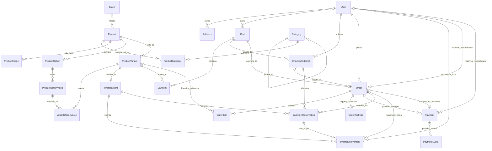

# Sellio — Entity Relationship Diagram

**Version:** 0.2 — 2026-11-19  
**Status:** Initial 22-table/13-enum migration applied and verified in sellio-dev on 2026-11-23; see the [verification record](initial-migration-verification.md).

The owner authorized Part A on 2026-11-20 and later separately authorized initial migration application. See [the foundation record](PRISMA_FOUNDATION.md) for implementation choices. Optional composite checkout ownership FKs are not adopted; accepted-payment same-order membership and approved custom SQL are deployed. The diagram and service minimums remain valid; domain services remain future work.

Read with the [database design](Sellio_DATABASE_DESIGN.md) and [implementation specification](DATABASE_IMPLEMENTATION_SPEC.md). [ADR-010](../decisions/ADR-010-checkout-attempt.md) approves CheckoutAttempt as entity 22, not every field below. No standalone ERD file existed before this revision; this diagram supersedes the embedded 21-entity conceptual diagram.

## 1. Complete relationship diagram

## 2. Physical cardinalities versus service invariants

- Approved cart ownership is exclusive: either a user_id or guest_token_hash, never both/neither. Non-null token hashes are unique; each authenticated user has at most one ACTIVE cart. The nullable User FK uses RESTRICT rather than SET NULL so parent deletion cannot create an ownerless cart. Claiming a guest cart updates owner and clears token atomically; merge behavior is future service work.
- Approved saved and historical line2/phone/region are nullable. Gross line totals precede taxes/discounts; order shipping/tax totals are required Decimal(12,2) with zero defaults. Existing Brand/product images/options remain; additional Brand archival, non-option attributes and variant media are deferred. No entity/cardinality is added by these scope decisions.

- There are exactly **22 distinct entities**. CheckoutAttempt is a customer-owned logical submission; Payment is an order's provider payment attempt. They are not interchangeable.
- The diagram shows FK/unique-key minimum guarantees. A product can physically have zero variants while being drafted; publication requires at least one valid variant, exactly one default and its balance. A unique variant FK gives at most one balance; creation/publication services ensure existence.
- An order can physically lack children before its creation transaction finishes. The service must create at least one OrderItem and exactly one OrderAddress atomically. A unique address FK alone cannot enforce existence.
- Implemented CheckoutAttempt.order_id is nullable and unique: the attempt may fail before producing an order, and an order cannot be the result of two attempts. V1 checkout services guarantee every placed order has its attempt; the child-side FK does not prove that minimum.
- Implemented Order.source_cart_id is required and unique: at most one order ever converts a source cart. Multiple historical attempts are permitted, with at most one live attempt enforced separately. Failed pending orders do not silently reactivate the historical cart; replacement-cart behavior remains later service policy.
- Cart.user_id is nullable for guests. CheckoutAttempt.user_id and Order.user_id are required. Same-owner and same-source relationships need approved composite FKs and/or locked service validation, not just unrelated UUID FKs.
- The accepted-payment edge is a second relationship between Payment and Order, not a second payment entity. Proposed composite membership FK ensures that the accepted Payment belongs to the order. Financial success remains independent of fulfillment acceptance; several Payment rows can be SUCCEEDED.
- Required InventoryReservation order/attempt links and optional movement.reservation_id are implemented and included in the baseline migration. Original movement.order_id and actor_user_id references are now shown explicitly. At most one SALE movement per reservation is an index/service rule, not the general movement-edge cardinality.
- Nullable PaymentEvent.payment_id permits events arriving before local association. It does not authorize deleting financial records. Reconciliation resolver references are optional proposed User FKs.
- Category cycles, complete option selections, reserved-balance sums, successful settlement validation and order snapshot immutability are not guaranteed by this diagram.

## 3. Keys and proposed schema refinements

All entities have UUID id PKs except ProductCategory(product_id, category_id) and VariantOptionValue(variant_id, option_value_id). Tables/columns map to snake_case. The implementation specification sections 3–10 define field types, enums, unique/partial indexes, checks and the relationship-by-relationship deletion matrix.

New/refined edges requiring approval: CheckoutAttempt ownership/cart/order; Order.source_cart_id and accepted_payment_id; required reservation checkout/order; movement.reservation_id; optional reconciliation resolver references. No edge directly references Supabase Auth tables, a mutable saved address as the only shipping record, a tenant or a warehouse.

The original baseline relationships are preserved except explicitly proposed refinements above. Required local order ownership is retained. The owner approved local migration preparation after resolving the four readiness gates; explicit approval is still required for database connection/application.
